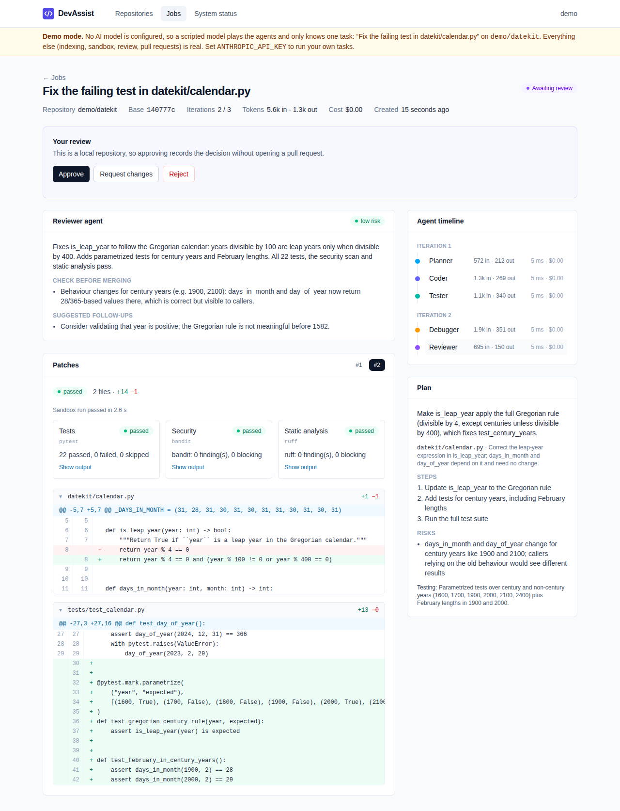
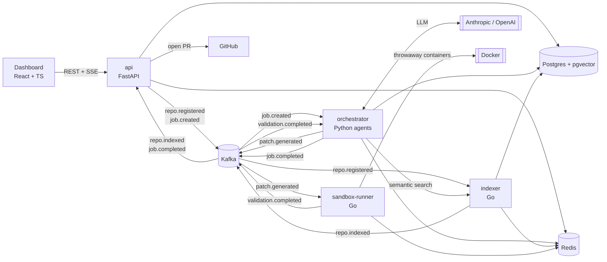

# DevAssist

[](https://github.com/Shaj2x/devassist/actions/workflows/ci.yml)

DevAssist is a multi-agent AI platform that takes a plain-English change request for a GitHub repository, plans it, writes the code and tests, and validates every patch in a locked-down Docker sandbox. Validated patches land in a review dashboard where a human reads the diff, the agents' reasoning, and the test/security/lint results, and approves it straight into a pull request.



## Architecture

Python (FastAPI) for the API and the agents, Go for the indexer and the
sandbox runner, Postgres + pgvector for data and embeddings, Redis for
locks, caches and live progress, and Kafka as the event bus between them.



A job goes **plan → code → test → validate ⇄ debug → review → human
decision**: the Planner reads the code it needs through semantic search, the
Coder and Tester write whole files (git computes the diff), the sandbox runs
tests, a security scan and static analysis, the Debugger fixes failures, and
the Reviewer writes the summary a human approves. Details:
[architecture](docs/architecture.md) · [agents](docs/agents.md) ·
[indexer](docs/indexer.md) · [sandbox](docs/sandbox.md) ·
[API and events](docs/api.md) · [operations](docs/operations.md).

## Quickstart

Requirements: Docker with Compose v2, and `make`. No API keys: the agents
use a scripted mock model and the indexer a local embedder until you
configure real ones.

```bash
git clone https://github.com/Shaj2x/devassist.git && cd devassist
make up
```

`make up` builds every image (the first build takes a few minutes), starts
the stack and waits until every service is healthy. Then open
**http://localhost:3000**, or run the whole flow from the terminal with
`make demo-api`.

| URL                          | What                       |
| ---------------------------- | -------------------------- |
| http://localhost:3000        | Dashboard                  |
| http://localhost:8000/docs   | API (OpenAPI / Swagger UI) |
| http://localhost:8000/metrics | Prometheus metrics (also on :8001, :8080, :8081) |

To use real models, set `LLM_PROVIDER=anthropic` and `ANTHROPIC_API_KEY` (or
`openai` and `OPENAI_API_KEY`) in `.env`; to open real pull requests, set a
fine-grained `GITHUB_TOKEN` with Contents and Pull requests write access.
`JOB_BUDGET_USD` caps what one job may spend.

## Demo walkthrough

### 1. Index a repository

`make up` publishes the demo repos in `sample-repos/` as local git remotes.
Index one and search it:

```bash
make demo-index                                  # clone, chunk, embed, store
make demo-search q="parse a duration like 1h30m"
```

```
1. datekit/parsing.py:20-27  [function parse_duration]  score=0.331
     def parse_duration(text: str) -> timedelta:
         """Parse compact durations like ``1h30m``, ``2d``, or ``45s``."""
```

How chunking, incremental reindexing and caching work:
[docs/indexer.md](docs/indexer.md).

### 2. Validate patches in the sandbox

Validate hand-written patches against the same sample repo. Each runs in a
fresh locked-down container (no network, read-only root, non-root, resource
and time limits) that is removed afterwards:

```bash
make demo-validate patch=datekit-fix-leap-year     # PASSED: 14 tests
make demo-validate patch=datekit-broken-fix        # FAILED: 3 failing tests
make demo-validate patch=datekit-insecure-helper   # FAILED: bandit B602 + ruff F821
```

```
status: FAILED  (1.1s)
  tests     passed   14 passed, 0 failed, 0 skipped
  security  failed   bandit: 2 finding(s), 1 blocking
      - B602 datekit/calendar.py:15 subprocess call with shell=True identified, security issue.
  static    failed   ruff: 1 finding(s), 1 blocking
      - F821 datekit/calendar.py:19 Undefined name `is_valid`
```

How isolation works, and the tests that try to break it:
[docs/sandbox.md](docs/sandbox.md).

### 3. Run the agents

Five agents plan, code, test, debug and review a change, validating every
patch in the sandbox. Without an API key the scripted mock LLM is used, and
its Coder deliberately gets the first attempt wrong so you see the debug loop:

```bash
make demo-run
```

```
 #  iter  agent     status     in_tok out_tok    cost $     ms
 1     1  planner   succeeded     572     212    0.0000      5
 2     1  coder     succeeded    1317     269    0.0000      5
 3     1  tester    succeeded    1103     340    0.0000      5
 4     2  debugger  succeeded    1865     351    0.0000      5
 5     2  reviewer  succeeded     695     150    0.0000      5

patches:
  iteration 1: superseded +14/-1 in 2 file(s)  [tests=failed security=passed static=passed]
  iteration 2: passed     +14/-1 in 2 file(s)  [tests=passed security=passed static=passed]

result: AWAITING_REVIEW after 2 iteration(s)
```

Set `LLM_PROVIDER=anthropic` and `ANTHROPIC_API_KEY` (or `openai` and
`OPENAI_API_KEY`) in `.env` to run real models. How the loop works and why it
cannot run forever: [docs/agents.md](docs/agents.md).

### 4. Review in the dashboard

Open <http://localhost:3000>, register `demo/datekit` with clone URL
`file:///sample-repos/datekit.git` (the form suggests it), click **New task**,
pick the example task and **Start agents**. The job page follows the agents
live over server-sent events: which agent is working, every patch with its
diff and sandbox results (tests, security scan, static analysis, full
output), the plan, and the Reviewer's verdict. Click any step in the
timeline to read the exact prompt and response. Then approve, reject, or
request changes, which sends your feedback back to the agents.


### 5. The same flow through the API and Kafka

The same flow, event-driven, the way the dashboard uses it: register the
repo (the indexer picks it up from Kafka), submit a task (the orchestrator
picks it up, and every patch goes to the sandbox runner and back over
Kafka), then approve:

```bash
make demo-api
```

```
==> waiting for the indexer (repo.registered -> repo.indexed)
==> submitting: Fix the failing test in datekit/calendar.py
    queued
    validating
    awaiting_review
  patch 1: superseded tests=failed security=passed static=passed
  patch 2: passed     tests=passed security=passed static=passed
  review (low risk): Fixes is_leap_year to follow the Gregorian calendar ...
Approve:  curl -X POST http://localhost:8000/v1/jobs/<id>/approve
```

For a real GitHub repository, put a fine-grained token with Contents and
Pull requests write access in `GITHUB_TOKEN`, register it with
`POST /v1/repos {"full_name": "owner/name"}`, and approving opens a pull
request. Endpoints, auth modes and delivery guarantees:
[docs/api.md](docs/api.md).

## Design decisions

**Why Go for the indexer and the sandbox runner.** Both are long-running,
I/O- and concurrency-heavy services with no ML in them: the indexer clones
repositories and parses thousands of files with tree-sitter in a worker
pool; the runner drives the Docker API, streams tarballs, and enforces
timeouts on processes it does not trust. Go gives cheap goroutines, a
first-class Docker SDK and tree-sitter bindings, real parallelism without a
GIL, and small static binaries. The agents stay in Python because that is
where the model SDKs, Pydantic schemas and fast iteration are.

**Why Kafka.** The pipeline is a chain of slow, independently failing steps
(indexing takes seconds to minutes, a job takes minutes, the sandbox is a
scarce resource). Kafka decouples them: the API answers in milliseconds, each
service scales on its own backlog (KEDA scales the workers on consumer lag),
a crashed worker's job is redelivered rather than lost, and poison messages
go to per-topic dead-letter topics with the error attached instead of
blocking a partition. Messages are keyed by job id, so one job's events stay
ordered. Delivery is at-least-once, so every handler is idempotent: a
`processed_events` ledger written in the same transaction as the handler's
effects, unique constraints, and a per-job Redis lock. Redis pub/sub could
not offer any of that: it forgets messages nobody is listening for.

**How the sandbox isolates untrusted code.** Patches are code written by a
model from a prompt that may have been written by anyone, so they are
treated as hostile. Each validation gets a fresh container with no network,
a non-root user with every capability dropped and `no-new-privileges`, a
read-only root with size-capped tmpfs scratch space, memory, CPU, PID and
file limits, and a `timeout` on every command; code is streamed in as a tar
archive, never bind-mounted, and the container is always removed. An
integration test submits a patch whose tests each pass only if an escape
works (network, root, writing to the image, finding the Docker socket, fork
bombs, memory bombs, infinite loops) and requires every one to fail.
Dependency installation is the one step that gets network, on a separate
bridge network disconnected before any patched code runs. In Kubernetes the
runner gets its own Docker-in-Docker daemon per pod, on a dedicated tainted
node pool. More in [docs/sandbox.md](docs/sandbox.md).

**How the agent loop avoids infinite retries.** Five independent stops:
an iteration cap (`MAX_ITERATIONS` validated patches per job, default 3);
stuck detection (every patch is fingerprinted, and a "fix" that reproduces an
earlier patch ends the job rather than paying for an identical sandbox run);
a dollar budget per job (`JOB_BUDGET_USD`, checked before every model call,
with exact token accounting); bounded model calls (per-attempt timeout,
bounded retries with exponential backoff, one repair attempt for invalid
JSON); and bounded message handling (a failing Kafka message is retried a
few times, then dead-lettered). The loop is a hand-written state machine, so
every transition and every exit is explicit and unit-tested, and a human
"request changes" starts a new bounded round rather than extending the old one.

**Whole files, not model-written diffs.** Agents return complete new file
contents and git computes the diff. Model-written unified diffs fail to apply
on a single miscounted hunk header; this cannot produce a malformed patch,
and the diff the reviewer approves is exactly what was validated.

**Pull requests without a clone.** The orchestrator stores each patch's
final file contents, so approving opens the PR through GitHub's Git Data API
(blobs, tree, commit, branch, PR), parented on the exact commit the agents
worked from. The API needs no git binary and no disk.

## Observability

- **Logs:** every service writes JSON lines with a `trace_id` (the job or
  repository id) that follows the work across HTTP calls and Kafka hops, so
  one job's story is one query: `make logs | grep <job-id>`.
- **Metrics:** every service serves Prometheus metrics on `/metrics`: HTTP
  traffic by route template, Kafka processed/retried/dead-lettered counts,
  agent steps, tokens, cost and latency per agent and model, job outcomes
  and iterations, sandbox results and slot waits, index runs and embedding
  reuse. Catalog and suggested alerts: [docs/operations.md](docs/operations.md).
- **Health:** `/healthz` (process alive) and `/readyz` (every dependency
  reachable) on every service, used by compose and by Kubernetes probes.

## Deploying to Kubernetes

Kustomize manifests live in [`deploy/k8s`](deploy/k8s): a `base` with the
five services (probes, resource limits, non-root and read-only containers,
HPA, PodDisruptionBudgets, default-deny NetworkPolicies, a migration Job),
a `dev` overlay that adds in-cluster Postgres/Redis/Kafka and the mock model,
and a `prod` overlay for managed infrastructure with GHCR images, GitHub
sign-in, KEDA autoscaling on Kafka lag and a dedicated sandbox node pool.

```bash
make k8s-dev        # kind cluster with everything in it, same demo as compose
make k8s-validate   # render every overlay and validate it against the schemas
```

## Continuous integration

GitHub Actions ([ci.yml](.github/workflows/ci.yml)) runs ruff, mypy
`--strict` and pytest; gofmt, go vet, golangci-lint and `go test -race` for
each Go module; eslint, tsc, vitest and a production build for the
dashboard; schema validation of every Kubernetes overlay; and the full
integration suite against the real stack (migrations, indexing, sandbox
escape attempts, the agent pipeline and the API end to end). Pushes to
`main` publish every image to GHCR.

## Development

You need [uv](https://docs.astral.sh/uv/), Go 1.24+, Node 22+ and
golangci-lint v2 for local tooling.

```bash
make install           # uv sync, go mod download, npm ci
make test              # unit tests: Python, Go, dashboard
make lint              # ruff + mypy --strict, gofmt + go vet + golangci-lint, eslint + tsc
make test-integration  # everything against the running stack (needs `make up`)
make logs s=api        # follow one service's JSON logs
make down              # stop (keeps data);  make clean  # stop and wipe volumes
```

Building behind a TLS-inspecting corporate proxy? See
[deploy/certs/README.md](deploy/certs/README.md).

## Repository layout

```
libs/devassist-common/   shared Python: config, JSON logging, events, DB models, Kafka, metrics
libs/gocommon/           shared Go: the same, for the Go services
services/api/            FastAPI service + Alembic migrations (owns the schema)
services/orchestrator/   the agents: providers, prompts, state machine, Kafka worker
services/indexer/        Go: clone, chunk, embed, semantic search
services/sandbox-runner/ Go: isolated patch validation
dashboard/               React + TypeScript + Vite review UI
proto/events/            JSON Schemas for every Kafka event + shared fixtures
sample-repos/            small demo repositories DevAssist works on
demo/patches/            hand-written patches for the sandbox demo
deploy/                  docker-compose, Kafka topic setup, Kubernetes manifests
docs/                    architecture and design notes
```

## What I'd do next

- **Evaluate the agents, not just test them.** A benchmark of real issues
  with hidden tests (SWE-bench style) run nightly per model and prompt
  version, tracking pass rate, iterations and cost per solved task, so prompt
  and model changes are measured rather than eyeballed.
- **Stronger sandbox isolation.** Run each validation as its own Kubernetes
  Job under gVisor or Kata Containers instead of nested Docker, removing the
  privileged sidecar entirely, and pre-warm a pool so validations start in
  under a second.
- **Smarter retrieval.** Combine embeddings with a symbol graph (callers,
  callees, imports from tree-sitter) and BM25, and let agents ask for more
  context mid-task through tool calls instead of one retrieval up front.
- **Incremental, event-driven indexing.** A GitHub App with push webhooks
  that reindexes only changed files, plus PR comments as a second review
  surface ("@devassist also handle 1900").
- **Multi-tenancy and cost controls.** Organisations and roles, per-user and
  per-org spend limits, rate limits, and audit logs of who approved what.
- **Tracing.** OpenTelemetry spans across HTTP, Kafka and model calls, so one
  job renders as a single trace next to its logs and metrics.
